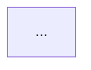
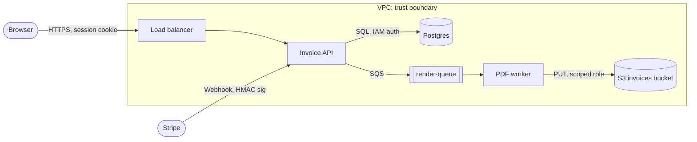

# Threat Modeling

Find design-level security problems before they are built. Draw the data flow, mark where trust changes, walk STRIDE at each boundary, and leave the team with a short list of threats, mitigations and owners.

## When to use

- A design doc, RFC or ticket describes a new feature, service, integration or data store.
- The user shares an architecture diagram (Mermaid, PlantUML, draw.io export, or a text description) and asks what could go wrong.
- A change adds a new trust boundary: a public endpoint, a third-party webhook, a new tenant model, a file upload, an admin panel, a queue consumer.
- Someone asks for a "security design review" or "STRIDE" before implementation.

Not for: reviewing code that already exists for OWASP bugs (use `security-audit`), triaging scanner output (use `sast-dast-triage`), or writing enforcement rules for the mitigations (use `policy-as-code`). IAM role details go to `cloud-iam-review`.

## Steps

1. Scope it. Write one paragraph: what the feature does, who uses it, what data it touches, and what is out of scope. If the design is too vague to name the data stores and callers, ask for them.
2. List assets. What would hurt if leaked, changed or made unavailable: credentials, PII, payment data, tenant data, signing keys, audit logs, availability of a core flow.
3. List actors. Anonymous user, authenticated user, other tenant, admin, internal service, third-party API, CI system, cloud provider, insider with read access to logs.
4. Draw the data flow diagram (DFD). Use Mermaid so it lives in the repo next to the design doc. Show external entities, processes, data stores, and every flow with protocol and auth method.
5. Mark trust boundaries. A boundary exists wherever the caller's privilege or the network zone changes: internet to load balancer, service to database, your cloud account to a vendor, browser to API, tenant A to shared worker.
6. Walk STRIDE per element. For each flow that crosses a boundary, ask the six questions in the checklist. Write a threat only if you can describe a concrete attack in one sentence.
7. Rate each threat. Use likelihood (low, medium, high) times impact (low, medium, high) to get a severity. Note any existing control that lowers it.
8. Pick a response per threat: mitigate, accept (with a named approver), transfer, or eliminate the feature path. Mitigations must be testable: "enforce `tenant_id` in every query through a repository layer, with a test that a cross-tenant ID returns 404" beats "add access control".
9. Assign an owner and a ticket for each mitigation. Accepted risks need a review date.
10. Write the output. Store it as `docs/threat-models/<feature>.md` next to the design so it gets reviewed in a PR and updated when the design changes.

## Checklist

STRIDE questions at each boundary crossing:

- Spoofing: How does the receiver know who sent this? mTLS, OIDC token with `aud` and `iss` checks, signed webhook (HMAC with timestamp), or nothing?
- Tampering: Can the payload or stored data be changed in transit or at rest? TLS 1.2+, signed URLs with expiry, checksums, DB write permissions scoped per service.
- Repudiation: If a user denies an action, can you prove it? Append-only audit log with actor, action, target, timestamp, source IP. Logs shipped off-host.
- Information disclosure: What leaks in errors, logs, URLs, caches, backups, analytics, or to other tenants? Are IDs guessable (sequential integers)?
- Denial of service: What is unbounded? Request size, upload size, pagination limits, regex on user input, fan-out to downstream calls, queue depth. Rate limits per user and per IP.
- Elevation of privilege: Can a user reach an admin path, act on another tenant's object (IDOR), or get code execution through deserialization, templates, or file processing?

Boundaries that are often missed:

- Background jobs and queue consumers that trust message contents because "only we write to the queue".
- Webhooks from SaaS vendors (Stripe, GitHub, Slack) without signature verification.
- Server-side fetches of user-supplied URLs (SSRF to `169.254.169.254` or internal services).
- Admin tools and support consoles that bypass tenant checks.
- CI/CD runners with deploy credentials that build untrusted PR code.
- Shared caches (Redis, CDN) keyed without tenant or user.
- Data exports, CSV downloads and backups.

Design controls worth checking for:

- Authorization decided server side per object, not per route only.
- Secrets fetched at runtime from Vault or a cloud KMS-backed store, not in env files baked into images.
- Least-privilege service identities (one role per service, not a shared one).
- Egress restricted for services that fetch URLs.
- Idempotency keys on payment and state-changing webhook handlers.
- Defaults are closed: new endpoints deny unless a policy allows.

See [references/stride-prompts.md](references/stride-prompts.md) for a longer prompt list per element type (process, data store, data flow, external entity).

## Output format

Write the model as markdown with these sections:

````markdown
# Threat model: <feature name>

Date: YYYY-MM-DD | Design doc: <link> | Reviewers: <names>

## Scope
One paragraph. In scope, out of scope.

## Assets
- <asset>: <why it matters>

## Data flow



## Threats

| ID | STRIDE | Element / boundary | Threat | Likelihood | Impact | Severity | Mitigation | Owner | Status |
|----|--------|--------------------|--------|------------|--------|----------|------------|-------|--------|
| T1 | ... | ... | ... | ... | ... | ... | ... | ... | open |

## Accepted risks
| ID | Reason | Approver | Review by |

## Open questions
- ...
````

Severity is the higher of likelihood and impact when either is high, otherwise medium. Sort the table by severity, then ID.

## Examples

### Bad threat entry

| ID | STRIDE | Threat | Mitigation |
|----|--------|--------|------------|
| T1 | I | Data could leak | Use encryption |

No element, no attacker, no concrete path. "Use encryption" does not say where or how to verify it.

### Good threat entry

| ID | STRIDE | Element / boundary | Threat | Severity | Mitigation | Owner |
|----|--------|--------------------|--------|----------|------------|-------|
| T4 | I, E | `GET /api/invoices/{id}` (browser to API) | Invoice IDs are sequential integers. A logged-in user of tenant A changes the ID and reads tenant B's invoice. | High | Switch to UUIDv4 IDs and filter every invoice query by `tenant_id` from the session. Add an integration test: tenant A token plus tenant B invoice ID returns 404. | @api-team |

### Data flow diagram



Boundaries to walk: browser to load balancer, Stripe to API, API to queue (does the worker trust `tenant_id` in the message?), worker to S3 (is the role scoped to one prefix?).
